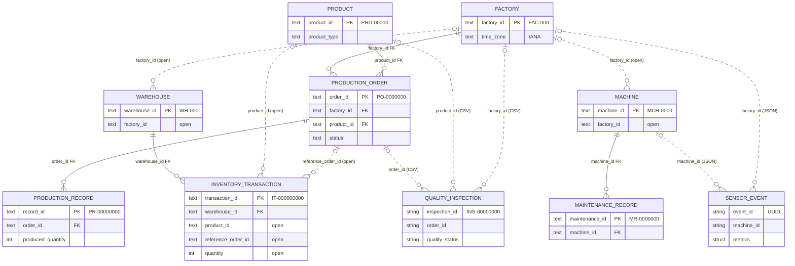

# ForgeLake Source Data Model

The five simulated source systems that ForgeLake ingests (plan Section 8). This page is the reference for the generator (Milestone 2) and for Bronze/Silver (Milestone 3 onwards).

| System | Delivered as | Contract |
|---|---|---|
| Production | PostgreSQL schema `production` | [`sql/source/001_production.sql`](../sql/source/001_production.sql) |
| Inventory | PostgreSQL schema `inventory` | [`sql/source/002_inventory.sql`](../sql/source/002_inventory.sql) |
| Maintenance | PostgreSQL schema `maintenance` | [`sql/source/003_maintenance.sql`](../sql/source/003_maintenance.sql) |
| Quality | Nightly CSV export | [`docs/sources/quality-csv.md`](sources/quality-csv.md), `forgelake.sources.contracts` |
| Machine Monitoring | Sensor events, JSON Lines | [`docs/sources/sensor-json.md`](sources/sensor-json.md), `forgelake.sources.contracts` |

The PostgreSQL schemas live in database `forgelake_source` (tests use `forgelake_source_test`) and are built by `scripts/init_source_db.py [--reset]`; see [setup.md](setup.md#postgresql-access).

## Entity-relationship diagram

Solid lines are foreign keys that PostgreSQL enforces. Dotted lines are references between systems that **nobody enforces at source**; Silver checks them.

## Identifier formats

Every entity has one text business identifier, the same in every system and file (design D1). The owning PostgreSQL table enforces its own format with a `CHECK`; references from other systems are not checked.

| Entity | Format | Example | Owner |
|---|---|---|---|
| Factory | `FAC-\d{3}` | `FAC-001` | `production.factory` |
| Product | `PRD-\d{5}` | `PRD-00042` | `production.product` |
| Production order | `PO-\d{7}` | `PO-0000123` | `production.production_order` |
| Production record | `PR-\d{8}` | `PR-00004567` | `production.production_record` |
| Warehouse | `WH-\d{3}` | `WH-002` | `inventory.warehouse` |
| Inventory transaction | `IT-\d{9}` | `IT-000012345` | `inventory.inventory_transaction` |
| Machine | `MCH-\d{4}` | `MCH-0007` | `maintenance.machine` |
| Maintenance record | `MR-\d{7}` | `MR-0000089` | `maintenance.maintenance_record` |
| Quality inspection | `INS-\d{8}` | `INS-00001234` | Quality CSV (not enforced) |
| Sensor event | UUID | `6f1c…` | Sensor JSON (not enforced) |

## PostgreSQL tables

Every table also has the change-tracking columns below. `NN` = `NOT NULL`.

| Column | Type | Rule |
|---|---|---|
| `created_at` | `timestamptz` NN | default `now()` |
| `updated_at` | `timestamptz` NN | default `now()`; a trigger sets `clock_timestamp()` on every update that doesn't set it explicitly. An explicit value is kept, which simulates late-arriving rows. Leads an index on every table (watermark extraction). |
| `is_deleted` | `boolean` NN | default `false`. Rows are soft-deleted; a trigger rejects `DELETE` on every table. |

### production.factory

| Column | Type | Rule |
|---|---|---|
| `factory_id` | `text` PK | `FAC-\d{3}` |
| `factory_name` | `text` NN | |
| `city` | `text` NN | |
| `country_code` | `char(2)` NN | ISO 3166-1 alpha-2 (not checked) |
| `time_zone` | `text` NN | IANA name, e.g. `Europe/Berlin`. Silver uses it to resolve CSV timestamps that lack an offset. |
| `opened_on` | `date` | |

### production.product

| Column | Type | Rule |
|---|---|---|
| `product_id` | `text` PK | `PRD-\d{5}` |
| `product_name` | `text` NN | |
| `product_type` | `text` NN | `finished_good`, `component`, `raw_material` |
| `category` | `text` | |
| `unit_of_measure` | `text` NN | `unit`, `kg`, `m`, `l` |
| `standard_cost` | `numeric(12,2)` | |

### production.production_order

| Column | Type | Rule |
|---|---|---|
| `order_id` | `text` PK | `PO-\d{7}` |
| `factory_id` | `text` NN | FK → `production.factory` |
| `product_id` | `text` NN | FK → `production.product` |
| `order_date` | `date` NN | |
| `due_date` | `date` NN | `>= order_date` |
| `planned_quantity` | `integer` NN | `> 0` |
| `status` | `text` NN | `planned`, `released`, `in_progress`, `completed`, `cancelled` |

Actual output is the sum of `production_record.produced_quantity`; it isn't stored on the order.

### production.production_record

| Column | Type | Rule |
|---|---|---|
| `record_id` | `text` PK | `PR-\d{8}` |
| `order_id` | `text` NN | FK → `production.production_order` |
| `production_date` | `date` NN | |
| `shift` | `text` NN | `A`, `B`, `C` |
| `produced_quantity` | `integer` NN | `>= 0` |
| `scrap_quantity` | `integer` NN | `>= 0` |

### inventory.warehouse

| Column | Type | Rule |
|---|---|---|
| `warehouse_id` | `text` PK | `WH-\d{3}` |
| `factory_id` | `text` | **open** (Production's factory) |
| `warehouse_name` | `text` NN | |
| `warehouse_type` | `text` NN | `raw_material`, `finished_goods`, `spare_parts` |
| `capacity_units` | `integer` | |

### inventory.inventory_transaction

| Column | Type | Rule |
|---|---|---|
| `transaction_id` | `text` PK | `IT-\d{9}` |
| `warehouse_id` | `text` NN | FK → `inventory.warehouse` |
| `product_id` | `text` | **open** (Production's product) |
| `reference_order_id` | `text` | **open** (Production's order; null for movements without an order) |
| `transaction_type` | `text` NN | `receipt`, `issue`, `transfer_in`, `transfer_out`, `adjustment` |
| `quantity` | `integer` NN | **open** (no range check) |
| `transaction_timestamp` | `timestamptz` NN | |

There is no stock-level table: stock on hand is derived from transactions in Gold.

### maintenance.machine

| Column | Type | Rule |
|---|---|---|
| `machine_id` | `text` PK | `MCH-\d{4}` |
| `factory_id` | `text` | **open** (Production's factory) |
| `machine_name` | `text` NN | |
| `machine_type` | `text` NN | `press`, `lathe`, `cnc_mill`, `welder`, `furnace`, `assembly_robot`, `paint_booth` |
| `manufacturer` | `text` | |
| `model` | `text` | |
| `installed_on` | `date` | |
| `status` | `text` NN | `active`, `inactive`, `retired` |

### maintenance.maintenance_record

| Column | Type | Rule |
|---|---|---|
| `maintenance_id` | `text` PK | `MR-\d{7}` |
| `machine_id` | `text` NN | FK → `maintenance.machine` |
| `maintenance_type` | `text` NN | `preventive`, `corrective`, `breakdown`, `inspection` |
| `status` | `text` NN | `scheduled`, `in_progress`, `completed`, `cancelled` |
| `started_at` | `timestamptz` NN | |
| `ended_at` | `timestamptz` | null while open; `>= started_at` |
| `downtime_minutes` | `integer` | `>= 0` |
| `cost` | `numeric(12,2)` | `>= 0` |
| `technician` | `text` | |
| `notes` | `text` | |

## Enforcement matrix

Each schema stands in for an independent system: it is strict about its own data and can't validate other systems' keys (design D2, AD-1). Everything the source leaves open is a check the lakehouse owns. Dirty rows are kept in Bronze and handled in Silver (AD-3).

### Enforced by PostgreSQL

| Rule | Where | Error (SQLSTATE) | Test |
|---|---|---|---|
| Own key present, unique, in format | every table | `23502`, `23505`, `23514` | `test_source_rules.py` |
| Foreign keys within a schema | order → factory, product; record → order; transaction → warehouse; maintenance record → machine | `23503` | `test_orphan_within_a_schema_rejected` |
| Allowed values for status and type columns | see tables | `23514` | `test_undocumented_status_rejected` |
| Structural checks | `planned_quantity > 0`, `produced_quantity >= 0`, `scrap_quantity >= 0`, `due_date >= order_date`, `ended_at >= started_at`, `downtime_minutes >= 0`, `cost >= 0` | `23514` | (DDL) |
| No hard deletes | every table | `P0001` | `test_hard_delete_rejected_and_row_kept` |
| `updated_at` advances on update | every table | – | `test_update_advances_updated_at` |

### Open at source, checked in Silver

| Open rule | Dirt it allows (plan Section 9) | Silver check | Test proving it's open |
|---|---|---|---|
| `inventory.warehouse.factory_id` | `fac_1`, unknown or null factory | Normalise format, then must exist in `factory`; otherwise quarantine | – (same mechanism as `machine.factory_id`) |
| `inventory.inventory_transaction.product_id` | null or unknown product | Not null and must exist in `product`; otherwise quarantine | `test_null_cross_system_product_accepted`, `test_unknown_cross_system_product_accepted` |
| `inventory.inventory_transaction.reference_order_id` | unknown order | When not null, must exist in `production_order` | – (same mechanism as `product_id`) |
| `inventory.inventory_transaction.quantity` | `-50` units | `quantity >= 0`; direction comes from `transaction_type` (plan Section 12: non-negative inventory quantities) | `test_negative_inventory_quantity_accepted` |
| `maintenance.machine.factory_id` | `fac_1`, unknown or null factory | Normalise format, then must exist in `factory`; otherwise quarantine | `test_inconsistently_formatted_cross_system_factory_accepted` |

### File sources: nothing enforced at export

The CSV and JSON feeds have layout contracts (header, types, nesting) but no integrity enforcement. Their business rules are Silver checks, listed in full in their specifications:

| Feed | Silver checks |
|---|---|
| Quality CSV | `inspection_id` unique across exports (deduplicate); `accepted + rejected = inspected`; quantities `>= 0`; `quality_status` in `passed`, `failed`, `rework`; timestamps without offset resolved with `factory.time_zone`; `order_id`, `product_id`, `factory_id` must exist |
| Sensor JSON | Deduplicate by `event_id`; metrics within valid ranges (temperature −20…150 °C, vibration 0…50 mm/s, pressure 0…16 bar, runtime_hours ≥ 0 and non-decreasing per machine); `status` in `running`, `idle`, `stopped`, `fault`; `machine_id`, `factory_id` must exist; late arrivals flagged by comparing `event_timestamp` with ingestion time |
